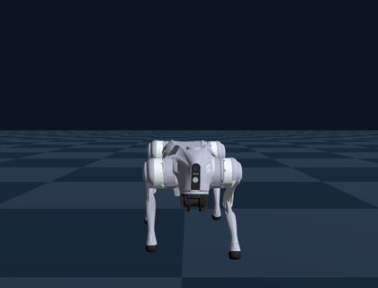
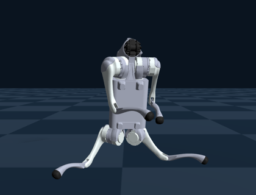
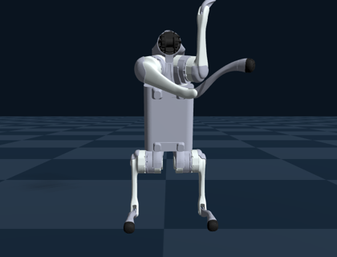

# Go2 に後ろ足で立つ動作を強化学習で学習させる

Physical AI 応用1講座 最終課題（j_shimokawatoko）

四足ロボット Unitree Go2 に、Genesis 上の強化学習（PPO）で、後ろ足で立ってバランスを保つ動作を学習させた。
Genesis 公式の Go2 歩行サンプルをもとに、アルゴリズム、ネットワーク、観測、行動は変えず、報酬と終了条件だけを変更している。

- 説明資料: [docs/説明資料_PAI最終課題_j_shimokawatoko.pdf](docs/説明資料_PAI最終課題_j_shimokawatoko.pdf)
- 動画: YouTube（URL は omnicampus に提出）

| 四足歩行（公式） | 2足立ち | 2足立ち・姿勢修正 |
|---|---|---|
|  |  |  |

## 公式サンプルからの変更点

ベース: [Genesis](https://github.com/Genesis-Embodied-AI/Genesis) v1.4.5 の `examples/locomotion`（Apache License 2.0、`src/LICENSE-Genesis`）

- `src/go2_env.py`: 報酬の関数を追加した（胴体の起き具合、胴体の高さ、前足の高さ、後ろ足の姿勢など）。終了条件を設定で選べるようにした。録画用のカメラを追加した。
- `src/go2_train.py`: `--task` で報酬の設定を切り替える（`walk` は公式のまま、`stand` は2足立ち、`stand-natural6` は姿勢修正）。`--resume` で学習済みモデルから続けて学習できるようにした。
- `src/go2_eval.py`: ビューアを使わずに mp4 に録画する。

報酬の各項目の計算方法と重みは、説明資料の3章にまとめている。

## 実行方法

macOS（Apple M1 Pro、16GB）で確認した。

```bash
uv sync      # Python 3.11, torch, genesis-world 1.4.5, rsl-rl-lib 5.5.2
cd src

# 学習（logs/<実験名>/ に保存される）
../.venv/bin/python go2_train.py --task walk  -e go2-walking  --max-iterations 101   # 四足歩行、約3分
../.venv/bin/python go2_train.py --task stand -e go2-stand-v1 --max-iterations 500   # 2足立ち、約16分
../.venv/bin/python go2_train.py --task stand-natural6 -e go2-stand-natural6 \
    --resume logs/go2-stand-v1/model_499.pt --max-iterations 600                   # 姿勢修正

# 推論と録画（../videos/ に mp4 が出る）
../.venv/bin/python go2_eval.py -e go2-stand-natural6 --ckpt 1999 --seconds 10
```

最終モデル（`src/logs/go2-stand-natural6/model_1999.pt`）だけ同梱しているので、推論はすぐ試せる。
なお、このモデルは途中の実験のモデルを何段か引き継いで学習したもので（合計約2000 iteration）、上の3行目のコマンドで同じものができるわけではない。

## ファイル構成

```
src/go2_env.py         環境（観測・行動・報酬・終了条件）
src/go2_train.py       学習
src/go2_eval.py        推論・録画
src/hello_go2.py       Genesis の最小例（Go2 を置いて PD 制御で立たせる）
src/eval_friction.py   床の摩擦を変えて転倒回数を比べる
src/summarize_log.py   学習ログの集計
src/logs/              最終モデルと設定
tools/make_video.py    提出動画の作成
docs/report.html       説明資料（PDF の元）
docs/notes.md          作業中のメモ（2足歩行の試行の記録を含む）
```
